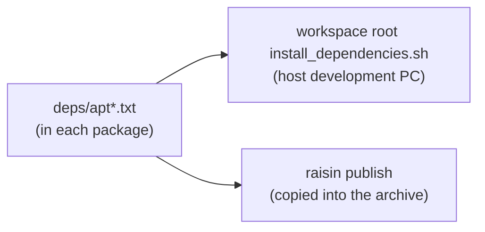

# deps/

Every raisin package declares the apt packages it needs in its own `deps/`. This file describes
those files once for all packages, raisin_master included. Read it before adding, removing or
moving a package in them.



The workspace root `install_dependencies.sh` (raisin_master) installs every list below at once.

## Files

| File | Contents |
|---|---|
| `apt.txt` | Libraries the package uses, and what it needs to **run**, every Ubuntu version |
| `apt.ubuntu-<version>.txt` | Same, for that Ubuntu version only |
| `apt.build.txt` | What **building, testing and analysing** it adds on top of `apt.txt` |
| `apt.build.ubuntu-<version>.txt` | Same, for that Ubuntu version only |

Every file is optional: create one only when it has a package to list. A package that needs
nothing from apt has none of them, and installing prints that nothing is declared and moves on.

## Format

- apt package names only, separated by spaces or newlines, one per line by convention.
  pip packages (raisin_master `requirements.txt`) and host setup such as udev rules, user groups
  or symlinks do not go here.
- `#` starts a comment. Write why the package is needed: which subpackage uses it, what it links.

```
# raisin_svt_av1 builds its assembly with nasm
nasm
```

## Which file

Decide in this order:

1. **The code links or includes it (a library)** → `apt.txt`, as the `-dev` package.
   Runtime library package names change between Ubuntu versions; the `-dev` name does not.
   Examples: `libssl-dev`, `libusb-1.0-0-dev`.
2. **Only building, testing, analysing or documenting uses it (a tool)** → `apt.build.txt`.
   Examples: `build-essential`, `nasm`, `pkg-config`, `cmake`, `clang-tidy`, `doxygen`, `gdb`.
3. Common cases settled in advance:
   - `libgtest-dev` → `apt.build.txt` (tests only).
   - `protobuf-compiler` → `apt.build.txt`; `libprotobuf-dev` → `apt.txt`.
4. A name already in `apt.txt` is not repeated in `apt.build.txt`.
5. Use an `ubuntu-<version>` file only when the package name differs by Ubuntu version
   (22.04 `libgeographic-dev`, 24.04 `libgeographiclib-dev`).
6. The package that uses a dependency directly declares it, even when another package already
   installs the same name; otherwise this package breaks when the other one drops it.

## Checking a change

1. **The name exists on every supported Ubuntu version.** Installing fails, and installs nothing,
   when any declared name has no installable candidate. On each version, `apt-cache policy <name>`
   must show a `Candidate:` other than `(none)`.
2. **Installing still succeeds:** run the workspace root `install_dependencies.sh`.
